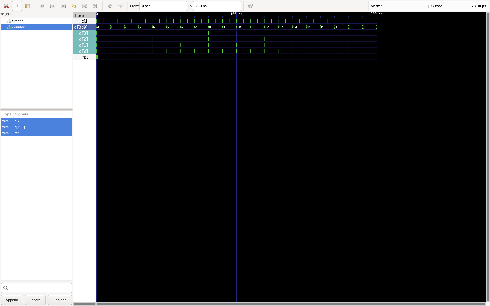

# RTL Verification: 4-Bit Synchronous Up-Counter (`counter.v`)

An incremental sequential RTL design and verification exercise using **Verilog**, **Verilator** (C++ simulation compilation), **cocotb** (Python testbenches), and **GTKWave** (waveform analysis), automated via a `Makefile`.

## Methodology

* **Verilator:** Compiles Verilog RTL into a C++ simulation model (`sim_build/Vtop`) linked with `cocotb`'s VPI interface.
* **cocotb:** Drives synchronous reset and verifies clocked state transitions and wrap-around in Python across simulation triggers (`Clock`, `RisingEdge`, `ReadOnly`, and `Timer`).
* **GTKWave:** Inspects recorded signal transitions (`dump.vcd`) with unsigned/decimal formatting on the multi-bit counter bus.

## RTL Design (`sandbox/counter.v`)

* **Inputs:** `clk` (1-bit positive-edge clock) and `rst` (1-bit active-high synchronous reset)
* **Output:** `q [3:0]` (4-bit unsigned count output, ranging from `0` to `15`)
* **Behavior:** Positive-edge-triggered sequential logic (`always @(posedge clk)`) using non-blocking assignments (`<=`) to clear `q` to `4'd0` when `rst` is asserted, and increment `q` by `4'd1` (`15 -> 0` wrap-around) otherwise

```verilog
module counter (
    input  wire       clk,
    input  wire       rst,
    output reg  [3:0] q
);
    always @(posedge clk) begin
        if (rst) begin
            q <= 4'd0;
        end else begin
            q <= q + 4'd1;
        end
    end
endmodule
```
## cocotb Testbench (`.py`)

* **Clock & Reset Driving:** Starts a periodic clock on `clk` and drives synchronous `rst` assertions/deassertions aligned to clock edges.
* **Directed & Wrap-Around Checks:** Tests synchronous reset clearing `q` to `0`, normal increment sequences across `0`–`15`, and `15 -> 0` roll-over.
* **Assertions & Readbacks:** Uses cocotb triggers (`Clock`, `RisingEdge`, `ReadOnly`, `Timer`) and explicit assertions to compare observed `q` values against the expected reference model at each cycle.

## Build & Simulation (`Makefile`)

* **Simulator & DUT Configuration:** Configures `SIM` (e.g., Icarus Verilog), `TOPLEVEL_LANG ?= verilog`, `VERILOG_SOURCES` pointing to `sandbox/counter.v`, and `TOPLEVEL = counter`.
* **Test Target:** Specifies `MODULE` for the Python cocotb testbench and runs the build/simulation flow via `make`.
* **Artifact Cleanup:** Uses standard `make clean` targets to remove generated simulation build directories and temporary logs between runs.

## Waveform Inspection (`GTKWave`)

* **Opening the Dump:** Launches `gtkwave dump.vcd` after simulation completes to inspect signal timing cycle by cycle.
* **Signal Setup & Bus Radix:** Adds `clk`, `rst`, and `q[3:0]` to the wave viewer, switching `q[3:0]` radix to **Unsigned** (decimal) to clearly track `0`–`15` counts and `15 -> 0` wrap-around transitions against `clk` and `rst`.

